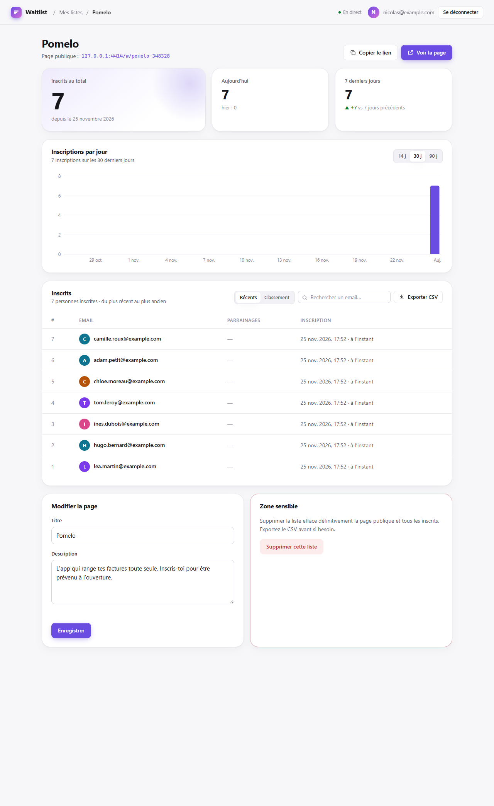
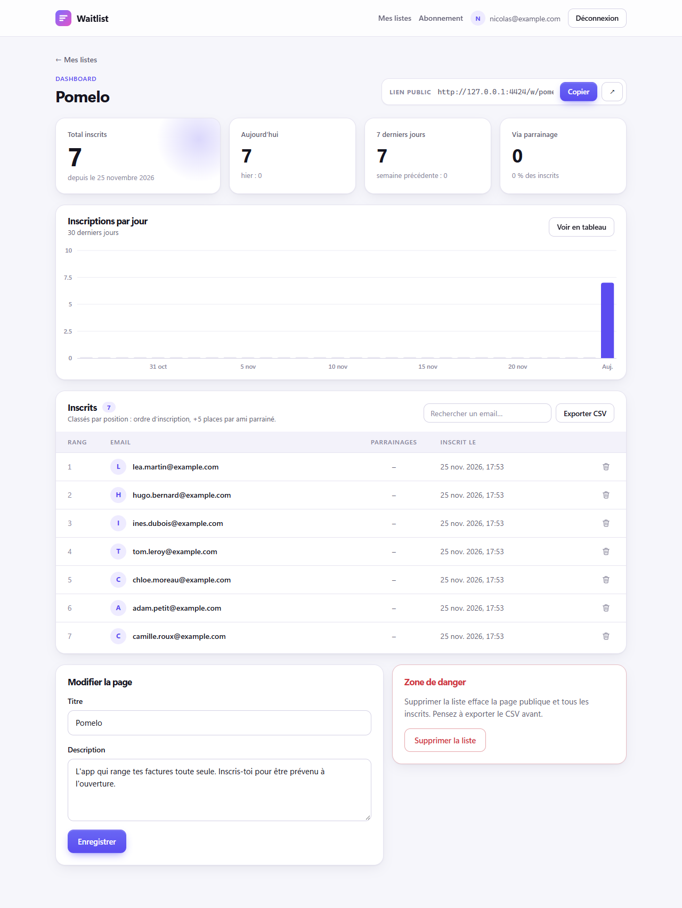
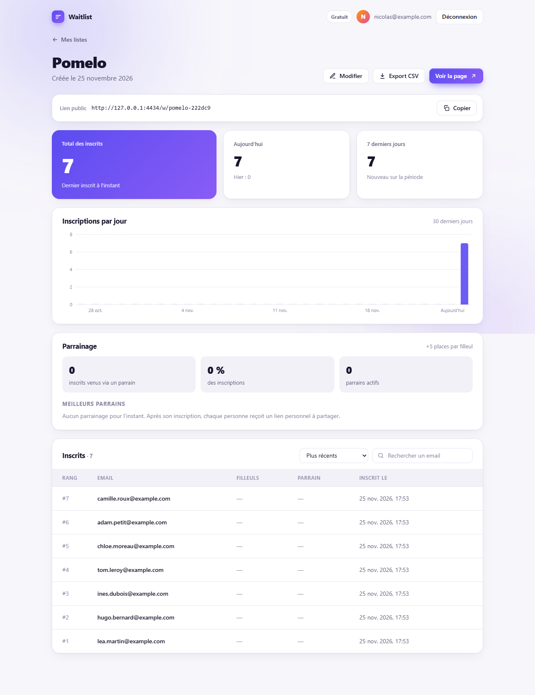

# waitlist-oneshot

Une expérience : demander à un agent de code de construire une app en un seul prompt, puis lui ajouter des fonctionnalités une par une, sans aucun cadrage. Trois essais indépendants, avec exactement les mêmes prompts.

Ce dépôt contient le code produit, ce que l'agent a dit avoir fait, et un audit de ce qu'il a réellement fait.

> **Ne déployez pas ce code.** Il est publié tel que l'agent l'a écrit, sans aucune correction. Les audits y relèvent des défauts connus.

## Le protocole

- **Date** : 25 novembre 2026.
- **Agent** : Claude Code 2.1.332, modèle Claude Opus 5.5, effort `medium`.
- **Réglages** : mode sans personnalisation (`--safe-mode` : pas de `CLAUDE.md`, pas de skills, pas de plugins, pas de serveurs MCP), dans un dossier vide.
- **Déroulé** : 5 prompts envoyés dans la même session, l'un après l'autre. Personne ne répond aux questions de l'agent.
- **Stripe** : aucune clé fournie.
- **Trois runs** lancés en parallèle sur la même machine.

Commande utilisée pour le premier prompt, puis `--resume <uuid>` à la place de `--session-id` pour les suivants :

```bash
claude -p "<prompt>" --model claude-opus-5-5 --effort medium --safe-mode \
  --dangerously-skip-permissions --output-format json --session-id <uuid>
```

`--dangerously-skip-permissions` laisse l'agent lancer n'importe quelle commande sans demander. À réserver à une machine où ça ne risque rien.

## Les 5 prompts

| Étape | Prompt |
|---|---|
| 0 | Construis-moi une app de listes d'attente. Je crée une liste pour mon projet, ça me donne une page publique avec un titre, une description et un formulaire email. Les gens s'inscrivent, et moi je vois les inscrits et le total dans un dashboard. Fais un truc joli. |
| 1 | Ajoute des comptes. Chacun se connecte et voit seulement ses listes. |
| 2 | Ajoute un plan payant avec Stripe : gratuit jusqu'à 100 inscrits, 9 € par mois en illimité. |
| 3 | Ajoute un export CSV des inscrits. |
| 4 | Ajoute le parrainage : chaque inscrit a un lien, et il monte dans la liste quand quelqu'un s'inscrit avec. |

## Lire le dépôt

| Dossier | Contenu |
|---|---|
| `run-1/`, `run-2/`, `run-3/` | Le code de chaque essai, dans son état final |
| `comptes-rendus/` | La réponse de l'agent à la fin de chaque étape, avec la durée et le coût estimé |
| `audits/` | Un rapport par run (en anglais), avec les scripts d'attaque et leurs sorties |
| `captures/` | Les écrans de chaque app à chaque étape |
| `prompts/` | Les 5 prompts, tels qu'envoyés |
| `outils/` | Les scripts qui ont lancé les runs et pris les captures, fournis tels quels |

**Un commit par run et par étape.** Le message du commit contient le prompt. Pour voir ce qu'un prompt a changé dans un run :

```bash
git log --oneline -- run-1
git show <commit> -- run-1
```

## Résultats

| | Run 1 | Run 2 | Run 3 |
|---|---|---|---|
| Durée totale | 34 min | 31 min | 30 min |
| Coût estimé au tarif public de l'API | 10,21 $ | 10,41 $ | 9,39 $ |
| Un compte lit les données d'un autre | Non | Non | Non |
| Passer en Pro sans payer | Non | Non | Non |
| Mots de passe, sessions, signature des webhooks Stripe | Propres | Propres | Propres |
| XSS, injection SQL, secrets en clair | Rien trouvé | Rien trouvé | Rien trouvé |
| **Limite des 100 inscrits du plan gratuit** | **Contournée** | **Contournée** | **Contournée** |
| Listes créées avant l'ajout des comptes | **Perdues** | Reprises | Reprises |
| Redirection ouverte après connexion | Oui | Non | Oui |
| Parrainage trichable avec de fausses adresses | Oui | Oui, plus difficile | Oui |
| Fichiers de test | 16 tests | Aucun | Aucun |
| Lignes au total à la fin | 3 773 | 2 557 | 2 761 |

Ce qui ressort :

- **Aucune faille critique.** Les fonctionnalités sensibles (comptes, paiement) sont celles qui tiennent le mieux.
- **La règle métier du prompt est contournable dans les trois runs.** Les trois agents ont décidé seuls de masquer les inscrits au-delà de 100 au lieu de bloquer les inscriptions. Un compte gratuit exporte ses 100 inscrits visibles, les supprime, et les suivants deviennent visibles.
- **Trois apps différentes pour les mêmes prompts.** Des tests dans un run et pas dans les deux autres. Des données reprises dans deux runs et perdues dans le troisième.
- **Une trentaine de décisions par run que personne n'a demandées.** Chaque rapport d'audit en donne la liste.
- **La même pile technique trois fois** : un serveur Node sans framework ni dépendance, avec le module SQLite intégré à Node, encore expérimental.
- **Le même design trois fois**, jusqu'au nom du produit et au logo.
- **Le compte rendu de l'agent ne suffit pas.** Dans le run 3, il écrit « les 32 tests passent » alors que le projet ne contient aucun fichier de test.

### Les trois dashboards à la fin

| Run 1 | Run 2 | Run 3 |
|---|---|---|
|  |  |  |

## Comment l'audit a été fait

Les audits ont été menés par des agents Claude, un par run, sans qu'ils connaissent les conclusions des autres. Chaque agent a relancé le code de chaque étape et l'a attaqué avec de vraies requêtes HTTP : deux comptes qui tentent de se lire, passage en Pro sans paiement, contournement de la limite, injections, reprise des données d'une étape à la suivante.

Chaque constat indique s'il a été **exploité** (l'attaque a réussi), **observé** (vu dans une réponse) ou seulement **lu** dans le code. Les rapports n'ont pas été revérifiés ligne à ligne par un humain.

## Limites du test

- **Une petite app** : 4 fonctionnalités et moins de 4 000 lignes. Le test ne dit rien d'un projet plus gros ou d'une session plus longue.
- **Stripe n'a jamais été appelé pour de vrai.** Les agents comme les audits ont utilisé un faux Stripe local.
- **Rien n'a été testé dans un vrai navigateur** pendant les audits. La redirection ouverte est prouvée au niveau HTTP.
- **L'étape 3 ne teste rien** : l'export CSV existait dès l'étape 0 dans les trois runs.
- **Les runs se sont gênés.** Lancés en parallèle, ils partageaient la machine : l'agent du run 3 a arrêté par erreur un serveur du run 1 pendant l'étape 2. Il le signale dans son compte rendu.
- **Un agent lancé en automatique ne peut pas poser de questions.** En session normale, il en aurait peut-être posé.
- **Les commits ont été reconstruits après coup**, à partir d'une copie du dossier prise à la fin de chaque étape. Les agents n'ont pas utilisé Git.
- **Les captures ont été prises après coup**, en relançant le code de chaque étape avec une liste d'exemple et 7 inscrits fictifs. À partir de l'étape 2, de fausses clés Stripe sont fournies pour que l'écran des tarifs s'affiche.
- **Une sévérité varie d'un rapport à l'autre** : le contournement de la limite est noté « high » dans deux rapports et « medium » dans le troisième. C'est le même défaut.
